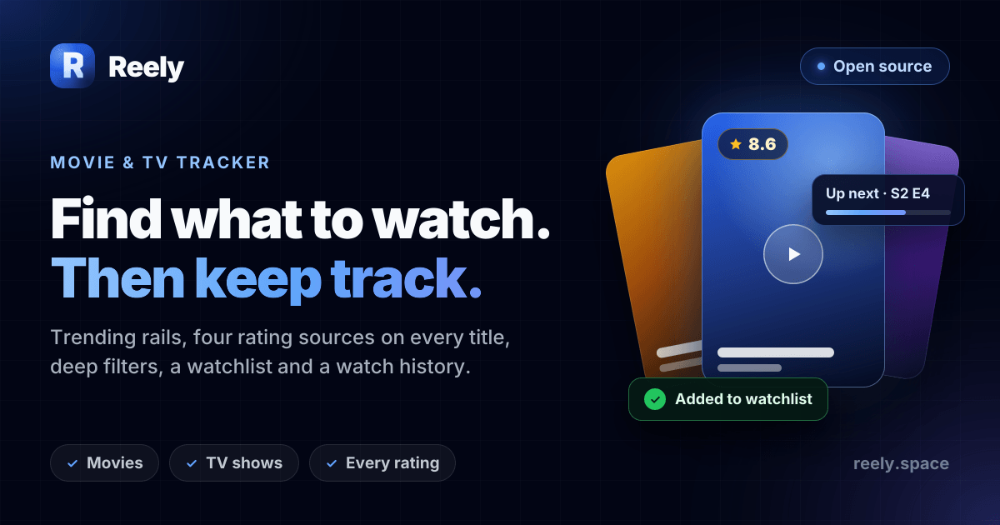

<a href="https://www.reely.space">
  
</a>

# 🎬 Reely

> The free, open-source movie and TV tracker. Find what to watch, stream it, track every episode, build lists, and watch together, with IMDb, Rotten Tomatoes, Metacritic and TMDB scores side by side.

[](https://github.com/Vette1123/movies-streaming-platform/actions/workflows/deploy.yml)


### 🚀 [Watch on Reely Space →](https://www.reely.space)

### 🎬 Watch the 26-second film

https://github.com/user-attachments/assets/9a34668e-a1e1-4313-9422-d4b1d1b9f8f5

**Vertical 9:16**, for Reels, TikTok and Shorts:

https://github.com/user-attachments/assets/604804f0-70b4-456c-a9df-d7e78aa441e5

[1080p, 16:9](docs/films/reely-film-1080p60.mp4?raw=true) · [vertical 9:16 for Reels, TikTok and Shorts](docs/films/reely-reel-9x16-60.mp4?raw=true). Both are 60 fps, cut to their own soundtrack and built from real screens of the app ([`video/`](video/README.md)).

## 📣 Sponsor Reely

**Put your brand in front of people choosing what to watch tonight.** One sponsor card per page, on the homepage, under every film and episode, and on nearly every page between. No popups, no ad network, nothing over the video.

### 📧 [Email booogado@gmail.com to book the slot](mailto:booogado@gmail.com?subject=Reely%20sponsor%20slot&body=Hi%2C%20I%20would%20like%20to%20sponsor%20Reely.%0A%0ACompany%20and%20website%3A%0AAffiliate%20%28referral%20link%20%2B%20coupon%29%20or%20a%20fixed%20month%3A%0AMonth%28s%29%20wanted%3A%0ACoupon%20code%20and%20what%20it%20gives%3A%0A)

Affiliate link with your coupon, or a fixed month. You get a monthly report of shows and clicks. [Slot details →](#-sponsors)

Reely is a free movie and TV show tracker built on the TMDB API. Browse what's trending, read four ratings at a glance, press play, and pick up exactly where you left off on any device.

- **Find it.** Trending, deep filters, mood picks, Reels, and ⌘K search across every film and show.
- **Watch it.** An in-page player with backup sources, skip intro and resume, plus a Kodi add-on for the TV.
- **Track it.** Watchlist, history, Next Up for airing shows, custom and public lists, stats, and alerts.
- **Share it.** Watch Together rooms with your phone as the remote, Match Night, taste-match Compare, and spoiler-safe share cards.

No account is needed to browse, rate or track; signing in only syncs your library across devices. Prerendered to static assets on Cloudflare's edge, so pages load instantly.

⭐ If Reely is useful to you, please star the repo.

## ✨ Features

- **TMDB-powered catalog** — trending, popular, top-rated, now-playing, and on-the-air movies and TV shows, pulled live from the TMDB API.
- **Animated hero slider** — auto-rotating display of trending media on the landing page, with a muted trailer that plays inline while a slide holds the frame. Autoplay is opt-out via an on-slide toggle, and starts switched off on low-power devices so a weak phone isn't handed a video player and a full-screen Ken Burns at once. Your explicit choice always overrides that default.
- **Browse movies & TV** — dedicated listing pages with a deep, live-applying filter system and infinite scroll (TanStack `useInfiniteQuery` + intersection observer).
- **Advanced filters** — sort, tri-state genre pills (include / exclude / off), TMDB rating, vote count, runtime, release year (decade chips + range slider), original language, age rating (certification), and _where to watch_ (streaming-provider logo grid + region picker). All filters live-apply on a 300ms debounce — no "Save" button — with an active-filter chips bar (tap to remove, or clear all) above the grid.
- **Detail pages** — synopsis, cast, similar titles, recommendations, trailer, and ratings, fetched in a single TMDB `append_to_response` call.
- **In-page streaming player** — watch movies and individual TV episodes, with up to five configurable sources to switch between, resume where you stopped, and skip intro. Supporters get the self-hosted Reely Player first (see the in-app disclaimer).
- **Season & episode navigator** — drill into any TV show by season and episode with a dedicated selector.
- **Trailers** — YouTube trailer dialog plus a hero trailer preview.
- **Collections** — franchise / collection pages that group a series of films.
- **Command-palette search (⌘K)** — instant, debounced search across movies and TV via a `cmdk` dialog, with All / Movies / TV chips and remembered recent searches. No page reload.
- **Genre pages & chips** — jump straight into any genre for movies or TV.
- **Four ratings** — IMDb, Rotten Tomatoes, Metacritic and TMDB side by side on every detail page, without spending a TMDB request on them. IMDb scores on list rows are opt-in (`NEXT_PUBLIC_IMDB_RATINGS`, prebuilt shards via `pnpm imdb:ratings`): enriching rows costs one subrequest per item against the Workers free-plan cap of 50.
- **Watchlist** — save titles you want to watch, kept on your device (no account required).
- **Watch history** — track watched movies and episodes, remove single items, or clear everything, on a dedicated page.
- **URL-synced filters** — every active filter lives in the URL via `nuqs`, so filtered views are shareable and back-button friendly (transient UI chrome like open accordions stays out of the URL, keeping shared links clean).
- **Web Share** — share any title through the native share sheet.
- **Accounts & sync (optional)** — sign in with Google to sync your watchlist, history, lists and progress across devices, link a TV or phone with a code, and import from elsewhere. Without an account everything stays in your browser.
- **Lists, profiles & RSS** — custom lists, public lists and profiles with their own share cards, and an RSS feed.
- **Next Up & alerts** — the next episode of everything you watch, an airing chip on shows with a new episode, and push alerts.
- **Watch Together** — a room for watching in sync, with your phone as the remote.
- **Match Night, Mood, Reels & Compare** — pick a film together with someone, pick by mood, scroll trailers as Reels, and compare tastes with a friend.
- **Stats & year cards** — your watching in numbers, plus shareable year cards and spoiler-safe share cards.
- **Kodi add-on** — Reely on the TV through Kodi ([reely.space/kodi](https://www.reely.space/kodi)).
- **Privacy-first** — no account required; without one, your watchlist, history and recent searches never leave your browser.
- **SEO & structured data** — full JSON-LD (Website, Organization, CollectionPage, Breadcrumb), Open Graph, Twitter Cards, dynamic OG image generation, sitemap, and robots.
- **Accessible & responsive** — skip-to-content, aria roles, a dedicated mobile nav, and a dark aurora UI that scales to phones.
- **Optimized imagery** — `wsrv.nl` CDN with an automatic TMDB origin fallback, driven by a custom `next/image` loader so every image still ships a real `srcset` and each device downloads the size it actually renders.
- **Installable PWA** — see the [Progressive Web App](#-progressive-web-app) section below.
- **Analytics built in** — PostHog product analytics, client-side only, with every event centralized in `lib/analytics.ts` and build-time source-map upload so minified production stack traces symbolicate.
- **Deployed on the edge** — see [Architecture](#-architecture) below.

## 📲 Progressive Web App

Reely is an installable PWA with a manifest and a working offline-resilient app shell.

- **Installable** — "Add to Home Screen" on Android/Chromium (native `beforeinstallprompt` nudge) and iOS (Share → Add to Home Screen hint). Runs standalone, portrait, with a black theme.
- **App shortcuts** — long-press the icon for **Browse Movies** and **Browse TV Shows** jump links.
- **Offline-resilient** — a hand-written service worker (`public/sw.js`, no `next-pwa`/serwist/Workbox) with a per-request caching strategy:
  - immutable `/_next/static/*` assets → **cache-first**
  - RSC navigation payloads (`?_rsc=`) → **stale-while-revalidate**
  - page navigations → **network-first**, falling back to the last cached page, then a custom `/offline.html`
  - icons, manifest, and images → **stale-while-revalidate**
  - never cached: the streaming player, `/api/*`, and any cross-origin request
- **Native touches** — maskable icons (192 / 512), Apple touch icon, theme colors, `browserconfig.xml` / mstile, and a Safari pinned-tab icon.

> Streamed video is live third-party content and is intentionally never cached for offline playback.

## 🏗️ Architecture

Reely ships as a **Next.js static export (`output: 'export'`) on Cloudflare Workers Static Assets**, plus one hand-written Worker for the parts that cannot be static. Next.js does not run in production at all.

This replaced an OpenNext deployment. Under OpenNext, 20–46% of Worker invocations were being killed on the free plan's 10ms CPU budget: any detail id outside the prerendered set re-rendered React on every request and could never become a cache hit, because Cloudflare will not edge-cache Worker-generated HTML. After the migration that figure is 0.0%, and p99 CPU went from ~700ms to ~8ms.

- Static assets match before the Worker runs. Every prerendered page is a plain file: zero CPU, and it doesn't count against the invocations cap.
- The Worker handles only what can't be static: `/api/*` (search, filtering, infinite scroll, season details, watch providers) and detail ids outside the prerendered set. A tail id costs one TMDB fetch plus an `HTMLRewriter` pass that injects the real title, OG/Twitter tags, JSON-LD, and a crawlable `<h1>`, so crawlers and unfurlers can't tell it from a prerendered page.
- No Server Actions. A static export can't contain them, so the browser talks to the Worker over HTTP, and the Worker calls the same `services/*` functions the build calls.
- `caches.default` is keyed by URL + Next build id, because cached fallback HTML references content-hashed chunks that the next deploy deletes.
- The real ceiling on site size is the 20,000-file asset cap. A static export writes ~10 files per route, so route depth is tuned in `lib/media-page.ts`.

Detail pages use TMDB `append_to_response` so a whole page renders on one TMDB request, and every TMDB call goes through a single governed client (`lib/fetch-client.ts`) with a concurrency cap and 429 backoff.

## 🛠️ Tech Stack

| Layer           | Technology                                                                                         |
| --------------- | -------------------------------------------------------------------------------------------------- |
| Framework       | Next.js 16 (App Router, Turbopack, RSC, static export) + React 19                                  |
| Language        | TypeScript 7 (native compiler; lint parses on TS 6)                                                |
| Styling         | Tailwind CSS 4 + `tailwindcss-animate` + `@tailwindcss/typography`                                 |
| UI              | shadcn/ui + Radix UI, `lucide-react` icons, Framer Motion, `sonner` toasts                         |
| Data fetching   | TanStack Query 5 + React Server Components                                                         |
| URL state       | `nuqs`                                                                                             |
| Search          | `cmdk` command palette + `use-debounce`                                                            |
| Infinite scroll | `react-intersection-observer`                                                                      |
| PWA             | Web App Manifest + hand-written service worker (no `next-pwa`/serwist)                             |
| Data source     | [TMDB API](https://www.themoviedb.org/documentation/api) + optional IMDb ratings + wsrv.nl imagery |
| Streaming       | Up to five configurable sources + the self-hosted Reely Player (ArtPlayer) behind a relay Worker   |
| Analytics       | PostHog (client-side only)                                                                         |
| Deployment      | Static export on Cloudflare Workers Static Assets + one hand-written Worker, D1 for accounts       |
| Tooling         | ESLint, Prettier, Vitest, Commitlint, Dependabot                                                   |

## 📖 Getting Started

### Prerequisites

- Node.js LTS (CI reads `.nvmrc`)
- pnpm 12
- A free [TMDB API key](https://www.themoviedb.org/settings/api)

### Install & run

```bash
pnpm install
pnpm dev
```

Open [http://localhost:3000](http://localhost:3000).

### Build for production

```bash
pnpm build:cf   # static export to out/ + bundle the Worker
```

`pnpm build` still runs a plain `next build` and is useful for diagnosing a prerender issue, but it is not what ships. The deployed artifact is the static export plus the Worker bundle. It prerenders ~1000 routes and is slow; for day-to-day work use the dev server.

### Deploy to Cloudflare Workers

A push to `main` deploys through CI (`.github/workflows/deploy.yml`). Locally:

```bash
pnpm preview      # build:cf + wrangler dev (the real workerd runtime)
pnpm waf:apply    # push the Cloudflare WAF + CDN cache rules
```

### Checks before a PR

```bash
pnpm lint             # ESLint
pnpm typecheck        # tsc on TypeScript 7
pnpm test             # Vitest: accounts, billing, sync, lists, offers
pnpm prettier:check   # formatting
```

Other scripts worth knowing: `pnpm d1:migrate` (D1 schema), `pnpm kodi:zip` (build the Kodi add-on), `pnpm cf:health` (production health), `pnpm relay:canary` (can the Reely Player play), and `pnpm sponsor:stats` (numbers for a sponsor).

### Environment variables

Copy `.env.sample` to `.env.local` and fill in the values you need. Only the TMDB variables and the app URL are required to run the app locally; the rest enable optional integrations. `.env.sample` documents every variable, including the backup stream slots (`NEXT_PUBLIC_STREAM_SOURCE_2..5`), the Reely Player (`NEXT_PUBLIC_PLAYBACK_WORKER_URL`, `PLAYBACK_TICKET_SECRET`), library sync (`LIBRARY_*`), push alerts (`NEXT_PUBLIC_VAPID_PUBLIC_KEY`) and search-console verification.

| Variable                                               | Description                                               |
| ------------------------------------------------------ | --------------------------------------------------------- |
| `TMDB_API_KEY`                                         | TMDB v3 API key (required)                                |
| `TMDB_HEADER_KEY`                                      | TMDB v4 bearer token used in request headers (required)   |
| `NEXT_PUBLIC_TMDB_BASEURL`                             | TMDB API base URL (e.g. `https://api.themoviedb.org/3`)   |
| `NEXT_PUBLIC_BASE_URL`                                 | Public base URL of your deployment (required)             |
| `NEXT_PUBLIC_STREAMING_MOVIES_API_URL`                 | Streaming source base URL used by the player              |
| `NEXT_PUBLIC_SEARCH_ACTOR_GOOGLE`                      | Google search URL template for actor lookups              |
| `NEXT_PUBLIC_IMDB_RATINGS`                             | `true` to enable IMDb ratings (optional, off by default)  |
| `NEXT_PUBLIC_POSTHOG_KEY` / `NEXT_PUBLIC_POSTHOG_HOST` | PostHog project credentials (optional)                    |
| `CLOUDFLARE_API_TOKEN`                                 | Cloudflare scripts (WAF, health); CI holds the deploy one |

## 🤝 Sponsors

Reely is free and stays free. Besides its supporters, it is paid for by one sponsor card per page: on the homepage, under every film and episode, and on nearly every page between. There are no popups, no redirects, nothing over the video, no ad network and no third-party script. Supporters never see the card.

When no sponsor is booked, the slot holds [Masareef](https://masareef.mohamedgado.com/?s=reely-readme), our own spending tracker. [Your brand here →](https://www.reely.space/advertise)

Want to back Reely yourself? [Email booogado@gmail.com](mailto:booogado@gmail.com?subject=Reely%20Pro%20%E2%80%94%20Any%20plan). Supporters get Pro once the payment is done ([reely.space/support](https://www.reely.space/support)), and never see the card.

|          |                                                                                             |
| -------- | ------------------------------------------------------------------------------------------- |
| Where    | Homepage, every film and episode page, and above the footer on nearly every other page      |
| Rotation | None: one sponsor holds the slot for the whole booking                                      |
| Period   | Calendar months, with start and end dates enforced in code                                  |
| Pay      | Per order through your affiliate link, or a fixed month paid once, arranged by email        |
| Extras   | Your coupon code on the card, a monthly report of shows, clicks and copies, and a line here |

Sponsor links are marked `rel="sponsored"`. Some links on the site are affiliate links, and Reely may earn a commission on orders made through them. **To book the slot, [email booogado@gmail.com](mailto:booogado@gmail.com?subject=Reely%20sponsor%20slot&body=Hi%2C%20I%20would%20like%20to%20sponsor%20Reely.%0A%0ACompany%20and%20website%3A%0AAffiliate%20%28referral%20link%20%2B%20coupon%29%20or%20a%20fixed%20month%3A%0AMonth%28s%29%20wanted%3A%0ACoupon%20code%20and%20what%20it%20gives%3A%0A).** Details are on [reely.space/advertise](https://www.reely.space/advertise).

<details>
<summary>Running the slot (maintainers)</summary>

- The catalogue is `config/offers.ts`. A booking is one entry: the sponsor's referral link as `href`, `coupon`, `from`/`until` dates and `weight: 10`. When no booking is live, Masareef fills the slot (`weight: 2`), with Rafiq as the fallback.
- `pnpm sponsor:stats` prints the last 30 days (people, visits, plays, countries, card shows and clicks) for a reply to a sponsor; `--write` refreshes the numbers on `/advertise`.
- `pnpm test` (`tests/offers.test.ts`) fails if a placeholder link goes live or a date is malformed.
- A booked sponsor's line in this README goes between dated markers, `<!-- sponsor:<id> until=<ISO instant> -->` and `<!-- /sponsor:<id> -->`, right under the Masareef line. `.github/workflows/expire-sponsors.yml` deletes it the day it ends and pushes, so nothing is left to remember; `pnpm sponsors:expire` runs the same thing locally.

</details>

## 🙌 Credits

Built by [Mohamed Gado](https://www.mohamedgado.com/). Data and imagery courtesy of [TMDB](https://www.themoviedb.org/). Reely is not endorsed or certified by TMDB.
